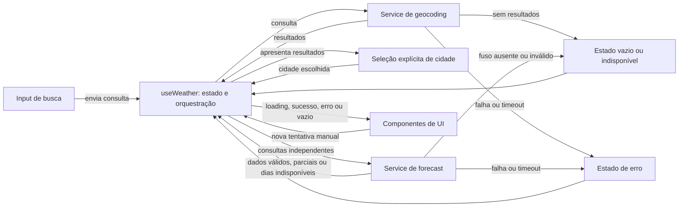

# Plano Técnico — Weather App

## Objetivo e rastreabilidade

Este plano deriva de `specs/weather-app-spec.md` e define arquitetura e contratos para a implementação, sem antecipar código final. A solução cobre pesquisa e seleção explícita de localidades, consulta independente dos painéis, conversão de unidades apenas na apresentação, estados acessíveis e recuperação manual.

| Requisitos da spec | Decisões relacionadas neste plano |
| --- | --- |
| RF-01, RF-02, RF-09; US-01, US-02 | Busca validada, até dez localidades e seleção explícita (Data Flow e External APIs). |
| RF-03, RF-04, RF-10; US-01, US-03 | Contratos de clima, datas no fuso da cidade e identificação da fonte (Data Model e Data Flow). |
| RF-05; US-04 | Celsius no modelo, conversão e formatação pt-BR na apresentação (Data Model e State Management). |
| RF-06, RF-07, RF-08; US-05, US-06 | Estados por operação/painel, timeout e retry manual isolado (Data Flow e Error Handling). |
| US-07; RNF-01, RNF-02, RNF-06, RNF-08 | Responsividade, acessibilidade, localização e compatibilidade (Project Structure e Testing Strategy). |
| RNF-03, RNF-04, RNF-05, RNF-07 | Desempenho, descarte de respostas obsoletas, clareza e privacidade (State Management e Testing Strategy). |

## Architecture

Aplicação cliente React em camadas. `App.tsx` compõe a tela e conecta a UI ao hook `useWeather`; componentes apresentam dados e encaminham ações, sem acessar rede. O hook coordena o fluxo e mantém estado de busca, seleção, painéis e unidade. Services isolam URLs, transporte HTTP e conversão de payloads externos para os contratos de domínio. `lib/` contém regras determinísticas sem efeitos colaterais.

As duas consultas meteorológicas são independentes, mesmo usando o mesmo endpoint. Assim, uma falha, timeout ou nova tentativa de um painel não bloqueia nem refaz o outro. As dependências seguem em direção à orquestração e aos serviços: componentes não importam serviços nem conhecem formatos externos; services não dependem de componentes; `lib/` não faz I/O. Não haverá backend, autenticação, cache persistente, armazenamento local, atualização automática pela rede ou chamada de geolocalização do dispositivo. O ajuste local dos dias na virada não é atualização de dados pela rede.

## Tech Stack

- **TypeScript strict, React 19 e Vite:** stack já configurada no projeto; React compõe a interface e o Vite serve desenvolvimento e build.
- **Tailwind CSS:** sistema de estilo já previsto no projeto, com layout responsivo e tema dark glassmorphism conforme as convenções do repositório.
- **Open-Meteo Geocoding e Forecast:** geocodificação e clima sem chave de API, conforme RF-01 e RF-03.
- **Vitest, Testing Library e Playwright:** testes unitários/de componentes e fluxos reais de navegador, conforme a stack configurada.
- **Biome e pnpm:** lint/formatação e gerenciador de pacotes existentes; sem novas dependências previstas para estado, datas ou chamadas HTTP.

## Project Structure

Estrutura proposta, compatível com as convenções do projeto. Os arquivos abaixo são pontos de partida para separar responsabilidades, não uma exigência de criar abstrações vazias:

```text
src/
├── components/                 # Apresentação; um componente por arquivo
│   ├── SearchForm.tsx          # Entrada, envio e erro de validação local
│   ├── CityResults.tsx         # Resultados distinguíveis e seleção explícita
│   ├── TemperatureUnitToggle.tsx # Alternância °C/°F
│   ├── CurrentWeatherPanel.tsx # Condições atuais e horário observado
│   ├── ForecastPanel.tsx       # Lista de cinco dias
│   └── states/                 # Loading, erro, vazio e indisponibilidade
├── hooks/
│   └── useWeather.ts           # Estado, ações, concorrência, retry e cancelamento
├── services/
│   ├── openMeteoClient.ts      # Fetch, timeout e classificação de erro
│   ├── geocodingService.ts     # Busca e normalização de localidades
│   ├── weatherService.ts       # Chamadas separadas para atual e previsão
│   └── openMeteoTypes.ts       # DTOs privados das respostas da API
├── lib/
│   ├── search.ts               # Trim e validação de consulta
│   ├── temperature.ts          # Conversão e formatação numérica
│   ├── weather-code.ts         # Mapeamento WMO para condição pt-BR
│   └── date-format.ts          # Datas/horários locais da cidade
├── types/
│   ├── city.ts                 # Cidade e estado da pesquisa
│   ├── weather.ts              # Condição, atual e previsão
│   └── async-state.ts          # Estados dos painéis e erro de domínio
├── App.tsx                     # Composição; conecta hook e componentes
├── main.tsx                    # Bootstrap React
└── styles/                     # Tailwind e estilos globais

tests/                          # Vitest/Testing Library e cenários Playwright
```

`App.tsx` chama `useWeather` e distribui estado e handlers aos componentes; não contém detalhes HTTP nem regras de domínio. `useWeather` controla a sequência das ações e expõe retries por operação. `openMeteoClient` centraliza timeout e falhas de transporte; os services específicos montam parâmetros e normalizam DTOs para os tipos compartilhados. DTOs externos ficam privados em `services/`, enquanto `types/` contém somente contratos internos. Componentes não fazem `fetch`; validação, conversão, mapeamento WMO e formatação ficam em funções puras testáveis sem renderização.

## Data Model

Os contratos abaixo representam o modelo de domínio normalizado; os formatos JSON da API permanecem restritos a `services/`. Valores opcionais ausentes não são convertidos em zero. `label` é texto pt-BR produzido a partir do código meteorológico, não texto fornecido diretamente pela API.

```ts
type Unit = 'celsius' | 'fahrenheit'; // Unidade exibida na interface.

interface WeatherCondition {
  code: number; // Código WMO da fonte.
  label: string; // Descrição pt-BR derivada do código.
}

interface City {
  id: number; // Identificador da localidade.
  name: string; // Nome da localidade.
  latitude: number; // Latitude em graus.
  longitude: number; // Longitude em graus.
  country?: string; // País, quando disponível.
  countryCode?: string; // Código do país, quando disponível.
  admin1?: string; // Região ou estado, quando disponível.
  timezone?: string; // Fuso informado pela geocodificação, quando disponível.
}

interface CurrentWeather {
  timeZone: string; // Fuso IANA da resposta meteorológica.
  temperatureC: number; // Temperatura em Celsius.
  apparentTemperatureC?: number; // Sensação térmica em Celsius.
  condition: WeatherCondition; // Código e descrição da condição atual.
  relativeHumidity?: number; // Umidade relativa em porcentagem.
  windSpeedKmh?: number; // Velocidade do vento em km/h.
  observedAtLocal: string; // Data e horário local fornecidos pela fonte.
}

type ForecastDay =
  | {
      status: 'available'; // Dados obrigatórios disponíveis.
      dateLocal: string; // Data civil local no formato YYYY-MM-DD.
      condition: WeatherCondition; // Código e descrição da condição diária.
      minimumTemperatureC: number; // Mínima em Celsius.
      maximumTemperatureC: number; // Máxima em Celsius.
      precipitationProbabilityMax?: number; // Probabilidade máxima em porcentagem.
    }
  | {
      status: 'unavailable'; // Dados obrigatórios ausentes.
      dateLocal: string; // Data civil esperada para a posição.
      missingFields: Array< // Campos ausentes na resposta para essa data.
        | 'dateLocal'
        | 'condition'
        | 'minimumTemperatureC'
        | 'maximumTemperatureC'
      >;
    };

interface FiveDayForecast {
  timeZone: string; // Fuso IANA da previsão.
  days: [ForecastDay, ForecastDay, ForecastDay, ForecastDay, ForecastDay]; // Cinco datas locais.
}

type NonEmptyArray<T> = [T, ...T[]];

type AsyncState<T> =
  | { status: 'idle' }
  | { status: 'loading' }
  | { status: 'success'; data: T }
  | {
      status: 'empty';
      reason: 'no-results' | 'no-data' | 'missing-required-data';
    }
  | { status: 'error'; error: WeatherError };

type CitySearchState = AsyncState<NonEmptyArray<City>>;
type CurrentWeatherState = AsyncState<CurrentWeather>;
type ForecastState = AsyncState<FiveDayForecast>;

interface WeatherData {
  city: City | null; // Cidade selecionada ou ausência de seleção.
  current: CurrentWeatherState; // Estado independente do clima atual.
  forecast: ForecastState; // Estado independente da previsão.
}

interface WeatherError {
  kind: 'timeout' | 'network' | 'rate-limit' | 'http' | 'invalid-response'; // Categoria da falha.
}
```

- `City` preserva somente dados geográficos fornecidos pela geocodificação; `admin1`, país, código do país e fuso não são inventados quando ausentes. A identidade escolhida deve incluir o `id` da resposta; latitude/longitude ficam disponíveis para as consultas.
- `AsyncState<T>` define os estados explícitos `idle | loading | success | error | empty`; `CitySearchState` usa `empty/no-results`, e o clima atual usa `empty/no-data` ou `empty/missing-required-data`. A busca bem-sucedida contém de um a dez resultados e ainda exige seleção explícita.
- `WeatherCondition.code` preserva o código WMO e `label` contém exatamente a descrição pt-BR da tabela da spec. Código desconhecido produz `Condição desconhecida`; código ausente torna o dado obrigatório indisponível.
- Temperaturas são mantidas em Celsius. A conversão para Fahrenheit ocorre ao renderizar e usa $F = C \times 9/5 + 32$; a formatação pt-BR limita a uma casa decimal. Vento fica em km/h, umidade e probabilidades em porcentagem.
- `CurrentWeather` exige temperatura, condição, horário local observado e fuso válido, conforme RF-03/RF-10; sensação térmica, umidade e vento são opcionais e não são substituídos por zero. Se um campo obrigatório ou fuso não puder ser normalizado, o estado é `empty/missing-required-data`.
- `FiveDayForecast.days` contém exatamente cinco posições, da data de hoje aos quatro dias seguintes no fuso da cidade selecionada. Cada dia é uma união discriminada: dados completos em `available`; falta de data, condição ou qualquer temperatura obrigatória em `unavailable`, com os campos ausentes identificados. Se nenhum dia estiver disponível, mas o fuso for válido, retornar `success` com cinco posições `unavailable` e informar a indisponibilidade no painel. Dados de precipitação ausentes são apenas omitidos. Sem fuso válido, o painel inteiro usa `empty/missing-required-data`.
- O hook mantém `CurrentWeatherState` e `ForecastState` independentes e não exige um agregado completo para renderizar o painel válido. O fuso de cada resposta meteorológica deve ser validado como identificador de fuso aceito por `Intl`; o fuso opcional do resultado geográfico não substitui um fuso ausente ou inválido na resposta meteorológica.
- `WeatherError.kind` é um código interno; a camada de apresentação traduz esse código em mensagem pt-BR e não expõe mensagens brutas da rede.

Contratos dos serviços, sem implementação:

```ts
interface GeocodingService {
  searchCities(query: string, signal: AbortSignal): Promise<City[]>;
}

type WeatherServiceResult<T> =
  | { status: 'success'; data: T }
  | { status: 'empty'; reason: 'no-data' | 'missing-required-data' };

interface WeatherService {
  getCurrent(city: City, signal: AbortSignal): Promise<WeatherServiceResult<CurrentWeather>>;
  getForecast(city: City, signal: AbortSignal): Promise<WeatherServiceResult<FiveDayForecast>>;
}
```

Os serviços retornam `success` ou `empty` para dados válidos e ausência de dados,
ou rejeitam com `WeatherError` para falhas; `idle` e `loading` pertencem ao hook.
O cancelamento por substituição é sinalizado separadamente e não vira erro visível.
`dateLocal` de cada posição indisponível é a data esperada, inclusive quando não
há registro na resposta; `missingFields` identifica `dateLocal` nesse caso.

## Data Flow



1. A tela começa sem cidade selecionada e com unidade Celsius. Nenhuma consulta ocorre até ação explícita do usuário.
2. No envio, a aplicação remove espaços externos e valida pelo menos dois caracteres não brancos. Entrada inválida atualiza uma mensagem acessível e não chama o serviço.
3. Uma busca válida inicia o estado de carregamento imediatamente e consulta geocodificação com `count=10`. Mostrar até dez resultados, na ordem recebida, mesmo se uma resposta contiver mais que o limite. A interface exibe nome e contexto geográfico disponível e aguarda seleção, inclusive se houver somente um resultado.
4. Ao iniciar outra busca, aborta-se a anterior quando possível e incrementa-se um identificador de requisição. Apenas a resposta cujo identificador ainda é atual pode alterar os resultados ou o erro visível.
5. Ao selecionar uma cidade, a identificação da seleção é atualizada e os dados da cidade anterior são ocultados ou limpos. O hook inicia em paralelo uma chamada para clima atual e outra para previsão; cada painel tem seu próprio estado e identificador de seleção/requisição.
6. Cada resposta é validada e normalizada antes de chegar à interface. Somente a chamada mais recente de cada operação pode atualizar seu estado, inclusive em seleções repetidas da mesma cidade; respostas de chamadas expiradas ou de outra cidade são ignoradas. A falha de uma chamada não impede a conclusão bem-sucedida da outra.
7. Uma nova tentativa chama somente o serviço do painel que falhou, com novo estado de carregamento; busca repetida usa a última consulta normalizada que falhou, mesmo se o campo tiver sido editado. Não existe retry automático.
8. A troca °C/°F altera apenas a unidade de apresentação; não provoca nova chamada e não modifica vento, umidade ou precipitação.
9. A previsão usa cinco datas civis calculadas a partir do relógio do dispositivo no fuso válido da resposta. Na virada local e no retorno de página suspensa, recalcular as posições com os registros em memória, sem chamada de rede; datas sem registro ficam indisponíveis. O usuário pode selecionar novamente a cidade para solicitar novos dados.
10. Junto aos dados meteorológicos apresentados, a interface identifica Open-Meteo como fonte e mostra a data e o horário local da observação para condições atuais válidas.

Para datas, solicitar `timezone=auto` e usar os valores de calendário locais retornados pela API. `dateLocal` é uma data civil (`YYYY-MM-DD`), não um instante UTC: não deve ser interpretada no fuso do dispositivo. O horário atual também é fornecido como horário local da cidade; sua apresentação pt-BR deve preservar esse horário, sem deslocá-lo pela zona local do navegador. Usar `Intl.DateTimeFormat` com componentes controlados ou formatação explícita dos componentes locais evita mudança de dia acidental.

## External APIs

Todas as chamadas são feitas no navegador, sem API key. Aplicar timeout individual de dez segundos a cada chamada; distinguir cancelamento por troca de consulta de timeout para não exibir cancelamento como erro.

Os exemplos abaixo mostram somente os campos consumidos pela aplicação; a API pode retornar metadados adicionais e valores diferentes. Os parâmetros de coordenadas do forecast vêm da cidade escolhida pelo usuário. O formato combinado é `https://api.open-meteo.com/v1/forecast?latitude={lat}&longitude={lon}&current={campos_atual}&daily={campos_diarios}&forecast_days=5&timezone=auto`. Para manter falhas e retries isolados conforme RF-06/RF-08, a aplicação envia duas requisições ao mesmo endpoint: uma com `current` e outra com `daily`, como detalhado a seguir.

### Geocodificação

- **Endpoint:** `GET https://geocoding-api.open-meteo.com/v1/search`
- **URL de exemplo:** `https://geocoding-api.open-meteo.com/v1/search?name=S%C3%A3o%20Paulo&count=10&language=pt&format=json`
- **Parâmetros:** `name` recebe a busca após trim e é codificado como parâmetro literal; `count=10` solicita até dez localidades; `language=pt` solicita nomes em português; `format=json` define o formato da resposta. Correspondências de acentos e grafias dependem da fonte.
- **Exemplo de resposta:**

```json
{
  "results": [
    {
      "id": 3448439,
      "name": "São Paulo",
      "latitude": -23.5475,
      "longitude": -46.6361,
      "country": "Brasil",
      "country_code": "BR",
      "admin1": "São Paulo",
      "timezone": "America/Sao_Paulo"
    }
  ],
  "generationtime_ms": 0.1
}
```

- **Normalização:** `results[]` vira `City`; usar `id`, nome e coordenadas, mapeando `country` e `country_code` para os campos correspondentes e preservando `admin1` e `timezone` somente quando presentes. `results` ausente, nulo ou lista vazia vira estado `empty`, não erro; `results` presente com outro tipo é `invalid-response`.

| Campo da resposta | Campo de `City` |
| --- | --- |
| `results[].id`, `name`, `latitude`, `longitude` | `id`, `name`, `latitude`, `longitude` |
| `results[].country`, `country_code` | `country`, `countryCode` opcionais |
| `results[].admin1`, `timezone` | `admin1`, `timezone` opcionais |

### Clima atual

- **Endpoint:** `GET https://api.open-meteo.com/v1/forecast`
- **URL de exemplo:** `https://api.open-meteo.com/v1/forecast?latitude=-23.5475&longitude=-46.6361&current=temperature_2m,apparent_temperature,relative_humidity_2m,weather_code,wind_speed_10m&temperature_unit=celsius&wind_speed_unit=kmh&timezone=auto`
- **Parâmetros:** `latitude` e `longitude` vêm da cidade selecionada; `current` solicita temperatura, sensação térmica, condição, umidade e vento; `temperature_unit=celsius` mantém o modelo em Celsius; `wind_speed_unit=kmh` fixa o vento em km/h; `timezone=auto` usa o fuso das coordenadas.
- **Exemplo de resposta:**

```json
{
  "timezone": "America/Sao_Paulo",
  "current_units": {
    "time": "iso8601",
    "interval": "seconds",
    "temperature_2m": "°C",
    "relative_humidity_2m": "%",
    "apparent_temperature": "°C",
    "weather_code": "wmo code",
    "wind_speed_10m": "km/h"
  },
  "current": {
    "time": "2026-11-11T14:00",
    "interval": 900,
    "temperature_2m": 23.4,
    "relative_humidity_2m": 61,
    "apparent_temperature": 24.1,
    "weather_code": 2,
    "wind_speed_10m": 12.6
  }
}
```

- **Normalização:** `current.temperature_2m`, `current.weather_code`, `current.time` e `timezone` válido são obrigatórios para `CurrentWeather`; o código WMO é traduzido para `condition.label`, e `current.time` é preservado como horário local observado. Sensação térmica, umidade e vento são normalizados quando presentes; se faltar um campo obrigatório ou fuso válido, o estado é `empty/missing-required-data`.

| Campo da resposta | Campo de `CurrentWeather` |
| --- | --- |
| `timezone` | `timeZone` |
| `current.time` | `observedAtLocal` |
| `current.temperature_2m` | `temperatureC` |
| `current.weather_code` | `condition.code`; `condition.label` vem da tabela WMO da spec |
| `current.apparent_temperature` | `apparentTemperatureC` opcional |
| `current.relative_humidity_2m` | `relativeHumidity` opcional |
| `current.wind_speed_10m` | `windSpeedKmh` opcional |

### Previsão diária

- **Endpoint:** `GET https://api.open-meteo.com/v1/forecast`
- **URL de exemplo:** `https://api.open-meteo.com/v1/forecast?latitude=-23.5475&longitude=-46.6361&daily=weather_code,temperature_2m_max,temperature_2m_min,precipitation_probability_max&forecast_days=5&temperature_unit=celsius&timezone=auto`
- **Parâmetros:** `latitude` e `longitude` vêm da cidade selecionada; `daily` solicita condição, máxima, mínima e probabilidade máxima de precipitação; `forecast_days=5` inclui hoje e os quatro dias seguintes; `temperature_unit=celsius` define unidade de origem; `timezone=auto` agrupa dias pelo fuso local da cidade.
- **Exemplo de resposta:**

```json
{
  "timezone": "America/Sao_Paulo",
  "daily_units": {
    "time": "iso8601",
    "weather_code": "wmo code",
    "temperature_2m_max": "°C",
    "temperature_2m_min": "°C",
    "precipitation_probability_max": "%"
  },
  "daily": {
    "time": [
      "2026-11-11",
      "2026-11-12",
      "2026-11-13",
      "2026-11-14",
      "2026-11-15"
    ],
    "weather_code": [2, 61, 3, 0, 2],
    "temperature_2m_min": [18.1, 17.4, 18.0, 19.2, 18.7],
    "temperature_2m_max": [27.2, 24.3, 25.8, 28.1, 27.5],
    "precipitation_probability_max": [10, 70, 25, 0, 15]
  }
}
```

- **Normalização:** associar os arrays `daily.time`, `weather_code`, `temperature_2m_min`, `temperature_2m_max` e, se presente, `precipitation_probability_max` pelo mesmo índice; indexar registros pela data civil retornada, nunca pela posição esperada. Construir as cinco datas esperadas no fuso válido da resposta e procurar cada uma no índice. Sem data correspondente, condição ou mínima/máxima, marcar somente a data esperada indisponível; a probabilidade ausente é omitida. Sem fuso válido, todo o painel fica indisponível. Reutilizar os registros normalizados em memória para a virada local.

| Campo da resposta | Campo de `FiveDayForecast` ou `ForecastDay` |
| --- | --- |
| `timezone` | `FiveDayForecast.timeZone` |
| `daily.time[i]` | `ForecastDay.dateLocal`, associado à data esperada |
| `daily.weather_code[i]` | `condition.code`; `condition.label` vem da tabela WMO da spec |
| `daily.temperature_2m_min[i]`, `daily.temperature_2m_max[i]` | `minimumTemperatureC`, `maximumTemperatureC` |
| `daily.precipitation_probability_max[i]` | `precipitationProbabilityMax` opcional |

Cada posição completa produz `ForecastDay` com `status: 'available'`; uma
posição sem dados obrigatórios produz `status: 'unavailable'`, a data esperada
e `missingFields`. `FiveDayForecast.days` contém exatamente cinco posições.
Clima atual e previsão alimentam seus estados independentes; não há resposta
`WeatherData` da API nem dependência de ambos para exibir um painel válido.

Em ambas as APIs, JSON malformado, raiz que não seja objeto ou estrutura presente com tipo incompatível gera `invalid-response`; valores meteorológicos ausentes ou nulos em estrutura válida seguem as regras de indisponibilidade, não são erro de transporte. Para eliminar a ambiguidade, `current` e `daily`, quando presentes e não nulos, devem ser objetos; os campos diários, quando presentes e não nulos, devem ser arrays. `results`, quando presente e não nulo, deve ser array. Elementos ou valores presentes com tipo incompatível geram `invalid-response`; valores nulos ou ausentes são tratados como dados ausentes. O fuso ausente, nulo ou inválido, inclusive com tipo incorreto, torna o painel meteorológico indisponível, conforme RF-03 e RF-04, e não gera retry de erro de rede. HTTP 429 é limite de requisições; outros status não bem-sucedidos são falha HTTP. Erro de rede, timeout e formato inesperado são classificados separadamente para uma mensagem clara e uma nova tentativa manual. Não há fallback de provedor nem cache persistente.

## State Management

O estado da tela vive em `useWeather`, sem store global. O hook expõe estado e ações; `App.tsx` os conecta aos componentes. Separar o estado em quatro áreas:

- **Pesquisa:** texto digitado e `CitySearchState` (idle/loading/success/empty/error).
- **Seleção:** `City | null`; escolher um resultado é sempre ação explícita.
- **Clima:** `CurrentWeatherState` e `ForecastState`, ambos `AsyncState<T>` e independentes.
- **Apresentação:** `Unit`, inicializada como Celsius em cada carregamento da página.

O hook `useWeather` vive no topo da tela, chamado por `App.tsx`; estado e handlers descem por props. No envio válido, atualizar busca para loading antes do request, mantendo a cidade e os painéis selecionados até nova seleção. Selecionar cidade incrementa a identidade da seleção e limpa/oculta os dados anteriores; ambos os painéis passam a loading. Resultados, falhas e retries só atualizam o estado da operação e da seleção que os originou. A `Unit` não dispara rede: as temperaturas em Celsius são convertidas e formatadas de forma derivada durante a renderização. Busca e preferência permanecem somente em memória: sem persistência local, URL ou servidor.

Cada operação de rede tem `AbortController` e identificador monotônico próprio; a expiração também invalida o identificador. Abortos de operações substituídas economizam trabalho, enquanto o identificador impede que respostas que já chegaram sobrescrevam estado mais novo. Geocodificação, clima atual e previsão diária podem concluir independentemente. Um timer para a próxima virada no fuso e o evento de retorno à visibilidade recalculam a janela da previsão em memória, sem rede; ambos são limpos ao trocar cidade ou desmontar o hook.

## Error Handling

- **Vazio inicial/sem resultados:** não há cidade nem clima presumidos; uma busca vazia apresenta mensagem específica e mantém o formulário disponível.
- **Loading:** busca e cada painel mostram seu próprio indicador. Atualizar estado no ciclo da interação para atender ao alvo de até 100 ms e anunciar a mudança com semântica acessível (`aria-busy` e região de status apropriada).
- **Falha de geocodificação:** manter a consulta normalizada e oferecer retry da busca; resultados antigos não devem ser apresentados como resposta da busca atual.
- **Falha do clima atual ou previsão:** apresentar erro e retry no painel correspondente, sem ocultar o painel que concluiu com sucesso.
- **Dados ausentes:** distinguir estado `empty` de erro HTTP/rede. Campo obrigatório ausente invalida o painel atual com razão `missing-required-data`; requisito obrigatório ausente em um dia invalida somente aquele dia; opcionais ausentes são omitidos, nunca substituídos por zero. Com fuso válido e nenhum dia disponível, exibir cinco posições indisponíveis; sem fuso válido, mostrar o painel inteiro indisponível.
- **Resposta inválida:** JSON malformado, raiz não objeto ou estrutura presente com tipo incompatível produz erro com retry. Em geocodificação, `results` ausente ou nulo é lista vazia; em dados meteorológicos, campo ausente ou nulo é indisponibilidade. Fuso ausente ou inválido torna o painel indisponível, sem retry de erro.
- **Timeout:** cada chamada é encerrada em dez segundos e classificada como timeout. Cancelamento por nova pesquisa/seleção é silencioso e não exibe erro nem retry.
- **Retry manual:** cada acionamento faz exatamente uma nova chamada da operação que falhou, sem retry automático. Loading e erro são atualizados somente para essa operação; em sucesso, o erro deixa de ser o estado atual.
- **Mensagens:** mapear códigos internos (`timeout`, `network`, `rate-limit`, `http`, `invalid-response`) para texto pt-BR; não expor mensagens brutas da rede.

Mensagens e botões devem ter nomes acessíveis em português, foco visível e fluxo por teclado. A seleção de localidades usa controles com semântica nativa; não depende de interação por mouse.

## Testing Strategy

### Vitest e Testing Library

- **Funções puras (`lib/`):** cobrir trim e validação (vazio, espaços, um caractere e mínimo válido); conversão °C ↔ °F incluindo 0 °C = 32 °F; arredondamento e separador pt-BR; mapeamento WMO conhecido/desconhecido; e formatação de data/hora sem deslocamento pelo fuso do dispositivo.
- **Services:** com `fetch` mockado, verificar URLs/parâmetros, normalização de DTOs, limite de dez resultados, ausência/nulidade e tipos inválidos. Para fuso ausente, nulo, inválido ou com tipo incorreto, verificar indisponibilidade sem retry de erro; para objeto ou array estrutural com tipo incorreto, verificar `invalid-response` e retry. Confirmar que fuso válido sem dias retorna cinco posições indisponíveis. Cobrir falha de rede, HTTP 429, outros status HTTP, timeout de dez segundos e cancelamento explícito sem classificá-lo como erro.
- **Hook (`useWeather`):** cobrir transições `idle | loading | success | error | empty`, seleção obrigatória inclusive com um resultado, falha parcial, retry que repete só a operação falha, resposta tardia após timeout e concorrência inclusive para a mesma cidade. Usar relógio controlado para virada local e retorno de suspensão, verificando as cinco datas e ausência de nova chamada.
- **Componentes (Testing Library):** verificar nomes acessíveis, mensagens de estado, operação por teclado, foco e ações de pesquisa, seleção, unidade e retry. Confirmar a identificação da fonte e o horário local da observação, que cada temperatura exibe sua unidade, que campos opcionais ausentes não aparecem como zero e que alternar unidade não altera vento, umidade ou precipitação.
- Usar timers controlados para timeout e respostas mockadas adiadas para concorrência. Os testes unitários não chamam a Open-Meteo real.

### Playwright

- **Fluxo principal:** interceptar API, pesquisar, escolher entre localidades homônimas, consultar painéis e alternar unidade; confirmar também que um resultado único exige seleção.
- **Validação e estados:** busca inválida não gera request; busca sem resultados mostra estado vazio; loading termina em sucesso ou erro; mensagens e retry refletem a operação.
- **Resiliência:** simular falha/timeout no clima atual e sucesso na previsão (e vice-versa); confirmar painel válido, retry isolado, ausência de repetição automática e descarte de respostas atrasadas.
- **Acessibilidade e responsividade:** percorrer busca, seleção, unidade e retry por teclado; verificar rótulos/estados anunciados, foco visível, contraste WCAG 2.2 AA (mínimo 4,5:1 para texto normal e 3:1 para texto grande/elementos não textuais) e ausência de rolagem horizontal em 320 px, 768 px e 1280 px.
- Usar `page.route`/fixtures para respostas previsíveis e independentes da rede pública. A configuração existente cobre apenas os projetos Chromium e mobile; ela não comprova toda a matriz RNF-08. Na fase Test, configurar os navegadores disponíveis no CI e registrar versão e resultado de cada alvo. O responsável pela entrega deve validar manualmente, em navegadores e dispositivos reais, as versões e plataformas não disponíveis no CI; documentar evidências e manter a entrega bloqueada enquanto algum alvo obrigatório não for validado. Emulação mobile e WebKit do Playwright não substituem a validação de Safari em iOS ou Chrome em Android.
- Complementar verificações automatizadas com auditoria WCAG 2.2 AA e uso de tecnologias assistivas nos fluxos de busca, seleção, consulta e retry; registrar resultados e corrigir falhas antes da entrega.

Verificar loading em até 100 ms e timeout após dez segundos. Para RNF-03, medir 100 consultas sequenciais no Chrome estável mais recente, desktop 1280 × 720, CPU limitada a 4× no DevTools, rede simulada com 100 ms de latência e respostas completas em até quatro segundos; o p95 entre ação e resultado visível deve ser até cinco segundos. Registrar sistema, hardware e versão do navegador; não inferir p95 de produção de uma única execução E2E.

Para mudanças em `src/` ou `tests/`, executar também os gates obrigatórios do
projeto: `pnpm lint`, `pnpm build` e `pnpm test`. O backlog em `tasks/` deve
existir antes de implementar; estes gates não se aplicam a alterações apenas em
documentos de planejamento.

## Risks & Trade-offs

| Decisão / alternativa | Trade-off técnico e mitigação |
| --- | --- |
| Chamadas separadas para atual e previsão, em vez de uma combinada. | Aumenta requests e pode repetir metadados/latência, mas isola falhas e retry por painel; manter resultados independentes e descartar respostas obsoletas. |
| Estado em hook local, sem biblioteca global. | Reduz dependências para uma tela e um fluxo; se a aplicação crescer para múltiplas telas, reavaliar o limite do hook antes de introduzir store externo. |
| Open-Meteo direto do navegador, sem backend/cache. | Evita infraestrutura e armazenamento de dados pessoais; depende de rede, CORS, disponibilidade e limites do provedor, sem fallback offline. Mitigar com loading, timeout, erros classificados e retry manual. |
| `timezone=auto` e datas civis da API, em vez do fuso do dispositivo. | Evita agrupar previsão no dia errado em viagens, mas exige impedir parsing implícito como instante local/UTC. Testar datas próximas à virada do dia. |
| `AbortController` junto de identificadores de request. | Cancelamento reduz trabalho, mas não garante sozinho que resposta já concluída seja ignorada. Usar ambos e testar respostas fora de ordem. |
| Mocks nos testes, em vez de depender da API ao vivo. | Torna os testes rápidos e repetíveis, mas não detecta sozinho mudanças no provedor. Conferir DTOs com a documentação/exemplos e fazer validação manual ou de integração não bloqueante quando apropriado. |
| Mapeamento WMO local e conversão de unidade na apresentação. | Evita requests e dependências para regras determinísticas, mas requer manutenção dos códigos e atenção ao arredondamento. Cobrir tabela de códigos e manter Celsius como dado canônico. |
| Horário de condições atuais como observação. | O horário da resposta não garante, por si só, uma medição instrumental. Verificar a natureza dos dados na documentação do provedor e validar a rotulagem com produto antes da entrega, sem alterar a spec unilateralmente. |
| Matriz das duas versões estáveis dos navegadores. | Aumenta tempo/custo e pode não caber integralmente no CI; combinar E2E nos alvos disponíveis com validação manual documentada dos demais como gate de entrega. |

## Review

| Problema identificado | Decisão incorporada |
| --- | --- |
| Previsão sem nenhum dia podia perder as cinco posições. | Com fuso válido, retornar cinco dias indisponíveis; sem fuso válido, indicar indisponibilidade do painel. |
| Contrato de serviço permitia estados de interface que o serviço não retorna. | `WeatherServiceResult` restringe o retorno a `success` ou `empty`; o hook controla os demais estados. |
| Matriz de navegadores e WCAG AA não tinham gates suficientes. | Complementar CI com validação manual documentada em navegadores reais e auditoria com tecnologias assistivas. |
| Gates obrigatórios de código não estavam explícitos. | Executar lint, build e testes após alterações em `src/` ou `tests/`. |
| Classificação de fuso inválido e tipos incompatíveis podia gerar estados diferentes. | Distinguir estruturas inválidas de dados ausentes; tratar fuso inválido como indisponibilidade e testar ambos os caminhos. |

Não há questões em aberto na spec que bloqueiem a implementação. A estrutura e os contratos acima devem alimentar a decomposição em tarefas, mantendo o escopo fora de autenticação, persistência, geolocalização, cache, atualização automática e previsão horária.